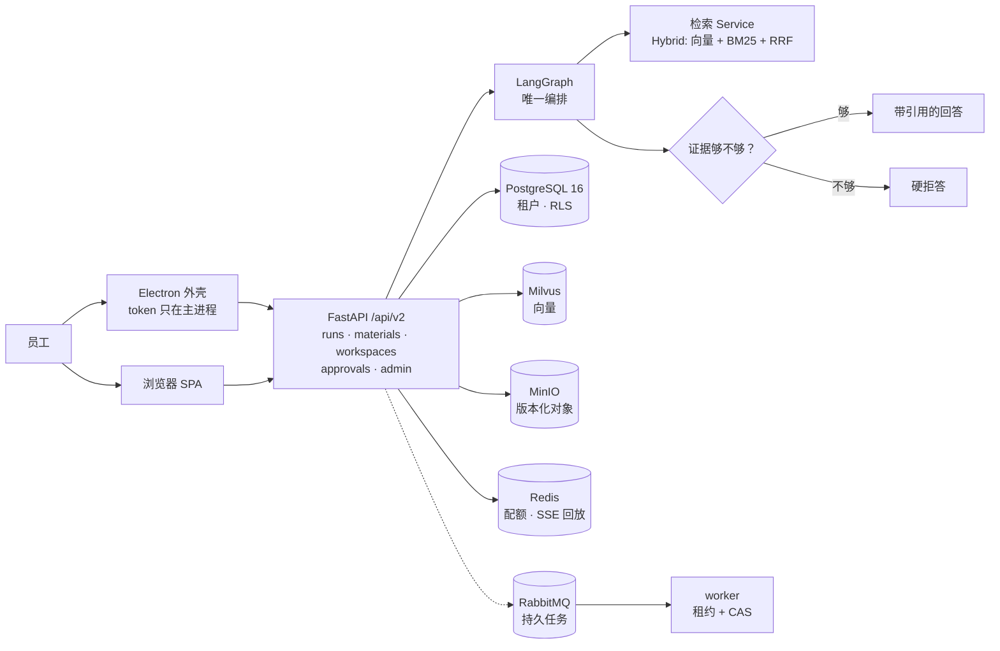

# PolicyFlow AI

**问公司制度，它先去翻你公司的文件，翻到了才回答，翻不到就说「查不到」。**

一个企业内部政策问答 + 流程助手。不是又一个「接个 API 就说是 AI Agent」的壳——它把「答案必须有出处」和「动真格的操作必须有人批」写进了代码，而不是写在 PPT 里。


<p align="center">
  
</p>

---

## 这玩意儿到底解决什么

企业里问「出差住宿标准多少」，员工一般三条路：翻共享盘、问 HR、问 ChatGPT。前两条慢，第三条会**一本正经地编**。

PolicyFlow 的做法很笨但很稳：

1. 把公司制度文档切块、索引、按租户隔离存好；
2. 员工提问 → 先检索 → **只有检到真文档才生成回答**，每句话带可点的引用；
3. 检索不到可靠依据 → 直接说「查不到，建议问 HR」，绝不拿模型记忆凑数；
4. 涉及「改材料 / 提交报销」这类**有副作用**的动作 → 沙箱出草稿，人来批，批准后至多执行一次。

一句话概括取舍：**宁可答不出来，也不答错。**

---

## 你能看到什么

| 模块 | 人话版 |
|---|---|
| **制度问答** | 流式输出，边检索边显示进度；回答每句能点回原文档；支持「给我个模板」这种短跟进（会自动补全上下文再检索） |
| **多轮记忆** | 记住你上次问的是「年假」还是「病假」，但**记忆不算证据**——不许用它替代制度原文 |
| **知识库** | 多库管理、上传即后台索引、按人授权可见；删库是真删（文件 + 向量 + 记录一起清） |
| **材料 / 工作区** | 按文件版本选材，能看 diff；政策原件**只读**，助手改不了 |
| **审批 / 提交** | 草稿 → 差异 + 哈希 + 副作用 + 有效期 → 人批 → 至多一次提交 |
| **评估中心** | 拿公开金标跑 Hit@1 / Hit@5 / Hit@10 / MRR，多检索策略对比，看板只聚焦主指标 |
| **管理员治理** | 租户内角色授予/撤销立即生效、配额健康、按 `run_id` 的脱敏审计时间线、失败任务恢复 |
| **桌面端** | Electron 外壳：渲染进程拿不到 token、拿不到 Node、拿不到任意文件；认证和 SSE 全走主进程代理 |

界面：React 19 + Vite + antd，浅色/深色双主题，16 个路由全部懒加载。

---

## 3 分钟跑起来

需要 Python 3.11+、Node 18+、conda（或自己建虚拟环境）。

```powershell
git clone https://github.com/Shen-An/policyflow-ai.git
cd policyflow-ai

conda create -n policyflow python=3.11 -y
conda activate policyflow
pip install -e ".[dev]"

copy .env.example .env      # macOS/Linux: cp .env.example .env
# 打开 .env，至少改这两个：
#   SECRET_KEY=<随便一串长随机字符串>
#   BOOTSTRAP_ADMIN_PASSWORD=<你的管理员密码>

cd frontend; npm install; cd ..
.\start.bat                  # 或 python start.py
```

浏览器开 `http://127.0.0.1:8000`，用 `admin` + 你刚设的密码登录。

**然后两件事必须做，否则问什么都是「查不到」**：

1. 进 **模型设置**，填 Chat 和 Embedding（任何 OpenAI 兼容服务都行）；
2. 进 **知识库**，上传几篇制度文档，等索引变绿。

> ⚠️ 这条路径用 SQLite + 进程内检索，**只适合开发和演示**。它不启 RLS、不校验 schema，不能用来证明租户隔离——要证明就得看下面的企业栈。

<details>
<summary><b>其他两种启动方式</b>（桌面外壳 / 完整企业栈）</summary>

**桌面外壳（Electron）**

```bash
npm --prefix frontend run electron:build   # 打包 renderer + main/preload
npm --prefix frontend run electron:start   # 本机启动
npm --prefix frontend run test:electron    # WDIO 安全套件
```

**企业栈（PostgreSQL 16 + Milvus + MinIO + Redis + RabbitMQ）**

```bash
docker compose -f infra/dev/compose.yaml up -d
```

```powershell
$env:DATABASE_URL = "postgresql+psycopg://<user>:<pass>@<host>:5432/<db>"
alembic upgrade 001                            # 1) expand：先加列
python -m migrations.backfill_legacy_tenant    # 2) backfill：可重跑，带账本和校验和
alembic upgrade head                           # 3) enforce：NOT NULL / 复合唯一 / FORCE RLS
```

直接 `alembic upgrade head` 会失败，**这是故意的**——没回填就收紧约束等于删数据。

</details>

---

## 检索效果怎么量（这里不吹）

主指标就四个：**Hit@1 / Hit@5 / Hit@10 / MRR**。报数必须带三样东西：**检索策略 + 样本量 N + 干扰设置**。少一样，这个数就没意义。

**为什么 README 里没有「Hit@5 = 0.93」这种数字？** 因为同一个代码，换 embedding 模型、换你的文档、换 N，结果就变。写死一个数挂在首页，那是营销不是工程。

**想拿到属于你的数字，三步：**

1. 评估中心 → 导入金标（本项目用公开中文问答集 `questanswer`，**只灌进「测试库」，业务库永不灌金标**）+ 建议再加 ≥200 篇干扰文档（不然 1 篇文档的小库轻松刷出 100%，那是自欺欺人）。
2. 随机抽 50 或 100 条起跑（别一上来全选几百条，多策略会成倍变慢）。
3. 看板读 Hit@1/5/10 + MRR；下拉能看到逐条命中的原始结果。

几个刻意的设计：

- **负样本绝不进 Hit@K/MRR**。「库里根本答不了的问题」没有金标，混进去要么白送 0 分要么白送满分；它们单独算「该闭没闭嘴」的拦截率（`negative_gate`），看板上 `N=` 只数正样本。
- **本地 rerank 是词法融合，不是 cross-encoder**。想要真模型重排可以按 run 选 NVIDIA cross-encoder（失败直接 503，不偷偷降级），两种都能 A/B。
- 1 篇文档整篇匹配的任务上，Hybrid 和 BM25 打平是正常现象。**打平就说打平**，不写成「Hybrid 显著更优」。

---

## 架构



四条不变量，代码里有对应测试：

- **一套编排**：问答、流式、评估、文件流程共用同一个编排入口，不存在第二套 stage 平行跑。
- **授权在服务端逐次判定**：身份只来自已校验的 membership；每次读写都现查权限；跨租户访问和「不存在」返回同一种 404（防枚举）。
- **高影响动作**：草稿 → 人工批准（现查权限 + 动作摘要 + 期望版本）→ 至多一次提交；正式政策原件永不改写。
- **可恢复**：run / job / SSE / 审批都有持久状态；能自动修的自动修，有歧义的升级人工，不猜。

---

## 工程质量（数字都是跑出来的）

| 项 | 现状 | 证据 |
|---|---|---|
| 后端测试 | **626 passed / 196 skipped / 1 failed**（全量跑，2026-10 记录） | `artifacts/acceptance/backend/`（原始输出 + SHA-256） |
| 前端测试 | **48 文件 / 162 用例全绿**（2026-10-21 重跑） | `npm --prefix frontend run test` |
| 契约测试 | 内部契约 22 passed + 1 xfail；OpenAPI v2 与运行时对齐 | `tests/contract/` |
| 压测 profile | 已实现 2200 用户画像（1000 会话 / 1000 SSE / 200 文件+隔离）、真实并发采集 | `tests/load/` |

**两件必须讲清楚的事**：

- **skip ≠ pass**。那 196 个 skip 大多是需要 PostgreSQL / Milvus / MinIO / Redis / RabbitMQ 的套件，依赖不在就跳过——所以报告里必须写出 skip 数，不能只报「626 passed」。
- 那 **1 failed** 是 `test_readiness_distinguishes_unmigrated_from_unreachable`：本机 PostgreSQL 没起，本该判「环境不可达」，用例没分类对。是测试分类缺陷，不是产品回归，记录在 `quickstart-validation.md` 里，没藏。

---

## 这个项目**没做**的部分

写在这里，是因为「敢说自己哪不行」比「全都行」更值钱。

1. **gVisor 沙箱没真起 pod**（没有 K8s 集群）。manifest 和策略完备，本机路径校验真跑，内核级隔离待集群。
2. **Electron 签名打包没真跑**（没企业证书）。签名门和 fuses 已实现并逐例验证，最终签名产物待证书。
3. **Electron E2E 目前是红的**：8 个 spec 全部失败在「建会话」阶段（`DevToolsActivePort file doesn't exist`）。日志能证明它启动失败，但证明不了唯一原因——这是待查项，不是「未运行」。
4. **容量数字没有**。1,000 并发 held-open SSE 和 30 分钟 soak 需要独立压测环境，本机跑出来的数不代表验收环境，所以不产出结论。
5. **功能验收表 16 项里，5 项 inconclusive、2 项 partial**：容量类全 inconclusive，可用性研究（真实用户）没做，新加的管理页没做无障碍 E2E。逐项判定在 `artifacts/acceptance/SC-001-SC-016.md`。
6. **旧路径还在**。老 adapter 和旧界面用「一个发布窗口零使用」来判定能不能删，窗口还没走完，所以没删——不是忘了。
7. **生产约束只在 PostgreSQL 上存在**。SQLite 上跑通不等于有 RLS、不等于有租户唯一约束。

还有一处架构债写明白：问答/评估的控制流目前跑在一张进程内图上，文件流程跑在另一张持久图上，**是两张图不是一张**。合并方案和最小切片写在 `specs/001-enterprise-agent-refactor/review-fixes-2026-10-21.md`。

---

## 目录

```text
backend/app/        FastAPI：api / services / graph / jobs / quota / storage
                    retrieval / sandbox / approvals / sse / db / auth / observability
frontend/src/       React SPA（features/* 按业务域）
frontend/electron/  安全外壳：main / preload / shared
migrations/         Alembic 分阶段迁移 001–005 + legacy 回填
infra/              compose.yaml、gVisor sandbox manifest
tests/              单元 / 契约 / 集成 / 安全 / 恢复 / 迁移 / 核对 / 负载
artifacts/          每个阶段的原始证据（不是截图，是日志和哈希）
specs/              SDD 规格；tasks.md 是进度权威
```

---

## 文档

| 想知道 | 去哪 |
|---|---|
| 到底做完了多少、每一项凭什么 | [`specs/.../tasks.md`](specs/001-enterprise-agent-refactor/tasks.md) ← 唯一权威 |
| 综合验收逐项判定 | [`artifacts/acceptance/SC-001-SC-016.md`](artifacts/acceptance/SC-001-SC-016.md) |
| 为什么不用「多智能体」那套词 | [`docs/08`](docs/08-de-toy-multiagent-skill-eval-strategy.md) |
| 数据库迁移 / 多租户 / RLS 怎么设计 | [`docs/12`](docs/12-postgresql-multitenancy-design.md) |
| 检索、评估、记忆的算法细节 | [`docs/04`](docs/04-ai-pipeline-rag-eval-design.md) |
| 一页看完定位与边界 | [`docs/10`](docs/10-project-summary.md) |
| 名词看不懂 / 要面试讲这套 | [`docs/interview/`](docs/interview/README.md)（含白话术语表） |

---

## 角色

| 角色 | 能干什么 |
|---|---|
| `employee` | 问答、写草稿、看被授权的知识库、发起/查看审批 |
| `kb_admin` | 维护知识库、审 FAQ、跑评估 |
| `sys_admin` | 管用户和角色、看审计、配 Skill/MCP/模型、租户治理 |
| `cross_tenant_admin` | 跨租户只读（平台容量这类），**默认谁都不给** |

## 几个坑先提醒

- 换了 embedding 模型或维度，**必须重建索引**，否则检索结果会莫名其妙。
- 记忆不会写进制度条款措辞，也不会覆盖当轮检索证据——这是刻意的。
- 生产必改 `SECRET_KEY` 和管理员密码；桌面端 token 只存在主进程的 OS `safeStorage` 里。

## License

MIT
