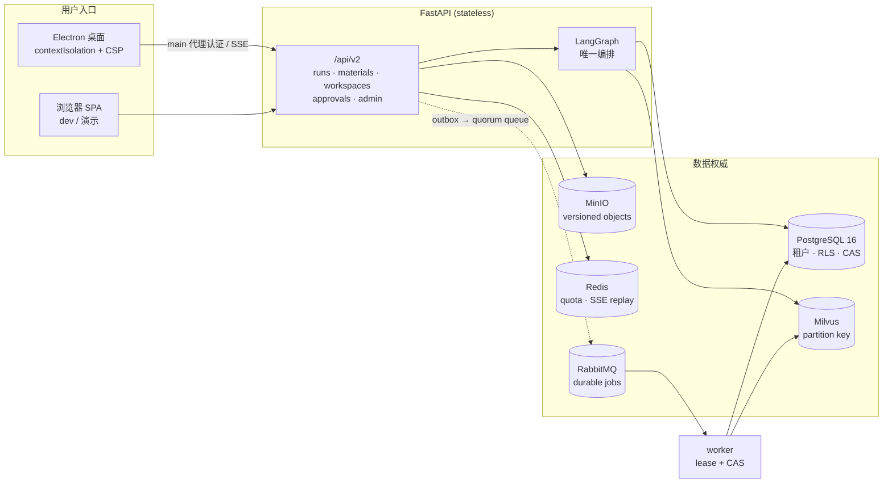

# PolicyFlow AI

企业内部政策问答与流程助手：**统一编排的 tool-using RAG**，以及围绕它的多租户、持久任务、版本化证据、沙箱审批与管理员治理。

对外只承诺两件事：**答案有证据**、**高影响动作有人批准且至多执行一次**。所有「本机没真跑」的部分在文档里显式标注 `[~]`，不用 mock 冒充绿灯。

> 进度与逐项证据以 [`specs/001-enterprise-agent-refactor/tasks.md`](specs/001-enterprise-agent-refactor/tasks.md) 为唯一权威；本文件只做入口导航与现状快照。

---

## 现在做到哪了

企业化改造按 Stage 推进，**Stage 1–9 已落地**；Stage 10（综合验收与旧路径退出）正在进行。

| 阶段 | 交付 | 状态 |
|---|---|---|
| Stage 1 | 迁移前容量基线（原始 CSV / 环境 / 哈希） | ✅ |
| Stage 2 | 无状态 API + PostgreSQL + 多租户/RLS + expand→backfill→enforce | ✅ |
| Stage 3 | 唯一共享 LangGraph；Chat/Eval 同一条编排；证据门 | ✅ |
| Stage 4 | durable job、outbox、配额、SSE 回放、恰好一次 | ✅（1000 held-open SSE 为规模压测 `[~]`） |
| Stage 5 | 版本化材料：对象存储（SHA-256）+ Milvus + saga + reconciliation | ✅（真实基础设施） |
| Stage 6 | 安全编辑与提交：workspace / change-set / action digest / 幂等 mock 提交 | ✅（gVisor 运行时 `[~]`） |
| Stage 7 | Electron 安全外壳（capability boundary，非成品 UI） | ✅（签名打包 `[~]`） |
| Stage 8 | 专业一致的桌面工作界面（chat / knowledge / workspace / approval / admin） | ✅ |
| Stage 9 | 管理员治理：租户 RBAC、配额健康、run 审计链、失败恢复、一致性修复 | ✅ |
| Stage 10 | 综合验收、数据权威切换、旧路径退出 | ⏳ 见下 |

任务清单：**145 `[X]` / 19 `[~]` / 0 `[ ]`（共 164）**。

Stage 10 里已经能诚实做完的、和**必须等真实窗口**的，分开看：

- 可做：契约测试（OpenAPI v2、internal-contracts）、数据保全核验、全量测试取证、SC 判定、文档与 quickstart 校验。
- 需等待：旧 adapter 的**一个 release window 零使用**观察（T158）；在其达标前，T159/T160 的旧路径删除**不会**执行。分布式 Locust 的 1000 会话 / 30 分钟 soak（T156）需要独立压测环境，本机结果只作为 smoke，不冒充验收数字。

---

## 架构总览



关键不变量：

- **单一编排**：Chat / stream / Eval / 文件工作流共享同一 graph；不存在第二套 stage。
- **授权在服务端逐次判定**：身份只来自已验证 membership；每次读写与副作用都 fresh 授权；跨租户访问与「不存在」同形（防枚举）。
- **高影响动作**：沙箱产出 draft → 人工批准（fresh RBAC + action digest + 期望版本）→ 至多一次提交；正式政策原件永不被改写。
- **证据优先**：无可靠证据默认硬拒答；记忆非权威，不得覆盖本轮检索证据。
- **可恢复**：run / job / SSE / 审批都有持久状态与恢复点；reconciliation 只做无歧义修复，其余升级人工。

---

## 三条启动路径

### 1. 开发 / 演示（浏览器 SPA，最快）

```powershell
conda activate policyflow
pip install -e ".[dev]"
cd frontend; npm install; cd ..

copy .env.example .env    # 至少设置 SECRET_KEY 与 BOOTSTRAP_ADMIN_PASSWORD
.\start.bat               # 或 python start.py
```

默认 `http://127.0.0.1:8000`。常用参数：`--dev`（Vite 热更新）、`--no-browser`、`--rebuild`、`--port 8080`。

这条路径用 SQLite + 进程内检索，**只适合开发与演示**：它不产生 RLS、不校验 schema 版本，也不能用来证明租户隔离。

### 2. 桌面外壳（Electron）

```bash
npm --prefix frontend run electron:build     # renderer + main/preload
npm --prefix frontend run electron:start     # 本机启动
npm --prefix frontend run test:electron      # WDIO 安全套件（真实 Electron）
```

renderer 没有 Node、任意文件、token 或 raw IPC；认证与 SSE 由 main 代理；导航 / 新窗口 / webview 全拒，外链仅 https allowlist。

### 3. 企业栈（PostgreSQL + Milvus + MinIO + Redis + RabbitMQ）

```bash
docker compose -f infra/dev/compose.yaml up -d
```

```powershell
$env:DATABASE_URL = "postgresql+psycopg://<user>:<pass>@<host>:5432/<db>"
alembic upgrade 001                            # expand
python -m migrations.backfill_legacy_tenant    # backfill（可重启，带账本与校验和）
alembic upgrade head                           # enforce（NOT NULL / 复合唯一 / FORCE RLS）
```

直接 `alembic upgrade head` 在未回填时会失败，**这是设计**。

---

## 功能地图

| 模块 | 能力 |
|---|---|
| 制度问答 | 多知识库联邦检索、引用溯源、证据门；无证据时硬拒答或明确标注「模型参考 · 不可信」 |
| 多轮记忆 | L0 消息 / L1 近窗+滚动摘要 / L2 事件摘要 / L3 实体；query rewrite；记忆非权威 |
| 知识库 | 授权可见；上传 → 扫描 → 索引 → 版本 → 可检索；物理删除（含对象版本与向量） |
| 材料 / 工作区 | 只按 version ID 选材；文件树 / 预览 / 版本 / diff；正式政策只读 |
| 审批 / 提交 | 沙箱生成 draft；diff + exact hashes + 副作用 + 有效期；approve/reject；至多一次 mock 提交（响应带 `status=mock`） |
| 评估中心 | 检索/回答用例、Run、CRUD 金标 **Hit@1 / Hit@5 / Hit@10 / MRR**、策略对比、负样本门控 |
| 管理员治理 | 租户内角色与授权（授予/撤销立即生效）、配额与用量、队列/索引健康、按 `run_id` 的脱敏审计时间线、失败任务恢复、一致性修复 |
| Skill / Tool / MCP | Skill = 证据绑定的业务规程；Tool 调用审计脱敏；MCP 走真 stdio/http，企业连接器 mock 显式标注 |
| 模型设置 / 用户 / 审计 | Chat 与 Embedding 独立 OpenAI 兼容配置（密钥加密）；用户/角色；系统审计 |

---

## 目录结构

```text
policyflow-ai/
├── backend/app/          # FastAPI：api / services / graph / jobs / quota / storage
│                         #   retrieval / sandbox / approvals / sse / db / auth / observability
├── frontend/
│   ├── src/              # React SPA（features/* 按业务域；含 admin 治理三页）
│   ├── electron/         # 安全外壳：main / preload / shared（capability boundary）
│   └── tests/electron/   # WDIO 安全 + 工作流 E2E
├── migrations/           # Alembic 分阶段迁移（001–005）+ legacy 回填
├── infra/                # dev/compose.yaml、k8s/sandbox-job.yaml（gVisor manifest）
├── docs/                 # 架构 / 数据库 / API / RAG·Eval / 策略 / 总结 / 面试知识库
├── specs/                # SDD 规格；tasks.md 是进度权威
├── artifacts/            # 各阶段原始证据（acceptance / admin / storage / recovery / ...）
├── tests/                # 单元 / 契约 / 集成 / 安全 / 恢复 / 迁移 / 核对 / 负载
└── start.py / start.bat
```

---

## 验证

```bash
# 后端：契约 / 单元 / 集成 / 安全 / 恢复 / 迁移 / 核对（不含压测）
pytest -q tests/contract tests/unit tests/integration tests/security \
          tests/recovery tests/migration tests/reconciliation

# 前端
npm --prefix frontend run typecheck
npm --prefix frontend run test
npm --prefix frontend run test:electron:e2e

# 容量 profile（需要独立环境；本机只跑 smoke）
python -m tests.load.baseline_runner --profile acceptance
```

证据都在 `artifacts/`，按阶段分目录；综合验收写在 `artifacts/acceptance/`（SC-001–SC-016 逐项判定、后端/桌面原始输出与哈希）。**skip 不等于 pass**：需要 PostgreSQL / Milvus / MinIO / Redis / RabbitMQ 的套件在依赖不可达时会 skip，报告里必须显示 skip 数。

---

## 诚实边界

1. **gVisor 运行时隔离未真起 pod**（无 K8s 集群）：manifest 与策略完备、本机路径校验真跑，内核级隔离待集群 → T092/T098 `[~]`。
2. **Electron 签名生产打包未真跑**（无企业证书）：签名门与 fuses 已实现并逐例验证，最终 signed artifact 待证书 → T121 `[~]`。
3. **1000 并发 held-open SSE 与 30 分钟 soak 未在本机验收**：功能与清理路径已验证，规模数字只认 T156 的独立环境证据。
4. **旧路径仍在**：legacy Chat/Eval adapter、`AgentPipeline` facade、local material/workspace、LightRAG 生产 workspace、Draft projection 与 browser shell 都带使用遥测；在 T158 的 release window 零使用达标前不删除（T159/T160）。
5. **数据权威切换未执行**：`003_authority_contract` 类 destructive contract 需要先有消费者清单与恢复点；当前只在 preflight 中拒绝，不自动反向迁移。
6. **生产约束只在 PostgreSQL 上存在**：SQLite 用于开发与隔离测试，不能用来证明 RLS / NOT NULL / 按租户唯一。
7. **LLM 指标口径**：Hit@K / MRR 只在标注的检索策略与 N 下有意义；1-doc 整篇匹配任务上 Hybrid 与 BM25 接近是正常现象，不据此宣称「显著更优」。

---

## 文档

| 文档 | 内容 |
|---|---|
| [tasks.md](specs/001-enterprise-agent-refactor/tasks.md) | **进度与逐项证据权威**（含每个 `[~]` 的原因） |
| [docs/08](docs/08-de-toy-multiagent-skill-eval-strategy.md) | 去玩具化 / Skill·Tool·MCP 诚实实现 / CRUD Eval 总策略；§10 为落地状态 |
| [docs/12](docs/12-postgresql-multitenancy-design.md) | 生产数据面：PostgreSQL、多租户、分阶段迁移、RLS |
| [docs/01](docs/01-architecture-design.md) · [02](docs/02-database-design-sqlite.md) · [03](docs/03-api-design.md) · [04](docs/04-ai-pipeline-rag-eval-design.md) | 架构 / 数据库 / API / AI·RAG·Eval |
| [docs/10](docs/10-project-summary.md) | 项目总结单页快照 |
| [docs/09](docs/09-interview-demo-script.md) · [docs/interview/](docs/interview/) | 面试演示脚本与分章知识库 |
| [artifacts/admin/us5/](artifacts/admin/us5/README.md) | 管理员治理：两租户 RBAC 矩阵、seeded fault、18 项检查 |

---

## 默认管理员

首次启动且库中无对应用户时，按环境变量幂等创建：

| 项 | 默认值 |
|---|---|
| 用户名 | `admin`（`BOOTSTRAP_ADMIN_USERNAME`） |
| 邮箱 | `admin@example.com` |
| 密码 | `.env` 的 `BOOTSTRAP_ADMIN_PASSWORD` |

登录后先在**模型设置**配置 Chat 与 Embedding（OpenAI 兼容），再到**知识库**上传文档等待索引。更换 embedding 模型或维度后必须重新索引。

## 角色

| 角色 | 能力 |
|---|---|
| `employee` | 问答、草稿、已授权知识库、材料选取与审批流发起/查看 |
| `kb_admin` | 知识库维护、FAQ 审核、评估 |
| `sys_admin` | 用户、审计、Skill/MCP、模型设置、租户治理 |
| `cross_tenant_admin`（独立 scope） | 平台容量等跨租户只读能力；默认不授予任何租户管理员 |

## 注意事项

1. 生产务必更换 `SECRET_KEY` 与管理员密码；桌面外壳中 token 只存在于 main（OS `safeStorage`）。
2. 通用请求默认 60s，制度问答 180s。
3. 记忆不进入「制度条款」措辞，也不覆盖本轮证据。
4. 知识库 / 文档删除是**物理删除**（对象版本、向量、SQL 记录）。

## 许可证

MIT
