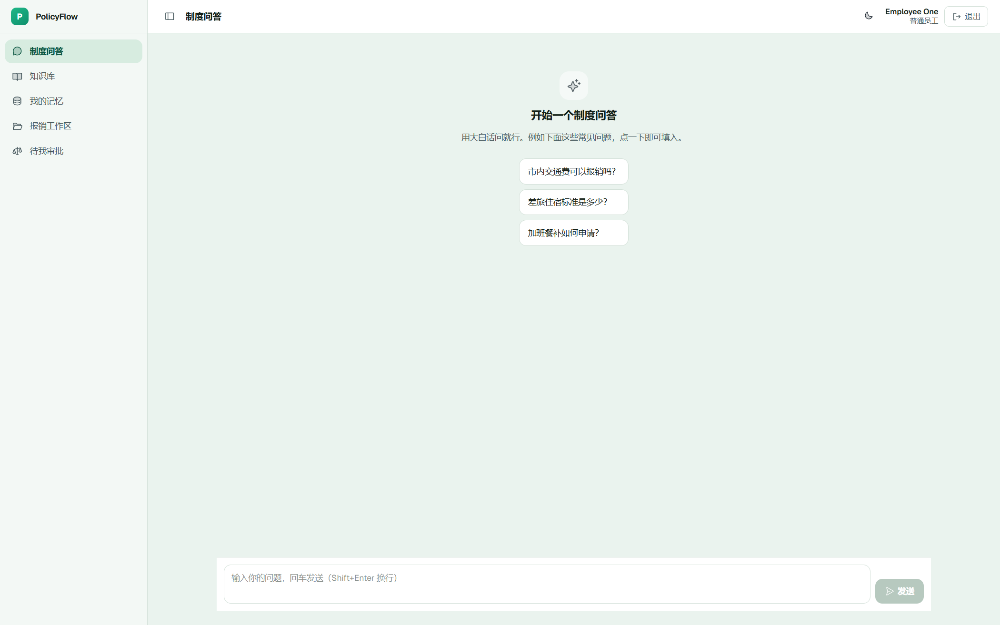
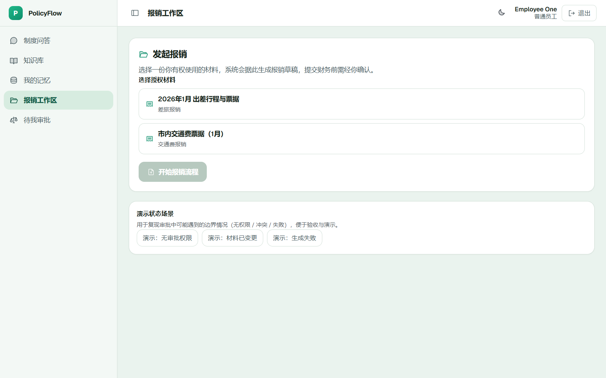
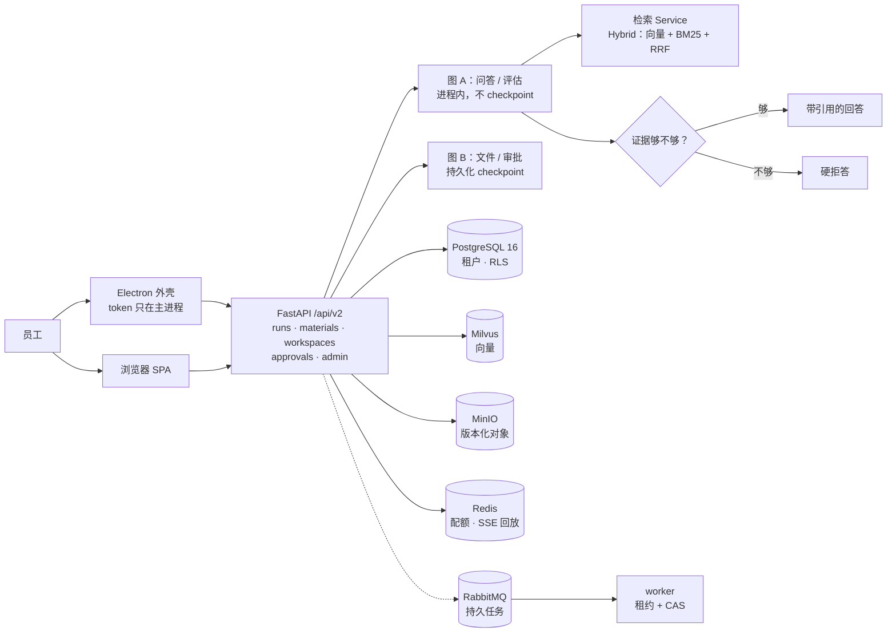

# PolicyFlow AI

**问公司制度，它先去翻你公司的文件，翻到了才回答，翻不到就说「查不到」。**

一个企业内部政策问答 + 流程助手。核心取舍只有一句：**宁可答不出来，也不答错。**

> 这份 README 的规矩：凡是写「已完成」的，后面都能翻到日志或测试；翻不到证据的，我就写「没做」或「没验过」。不留中间地带。


<p align="center">
  
</p>

---

## 这玩意儿到底解决什么

企业里问「出差住宿标准多少」，员工一般三条路：翻共享盘、问 HR、问 ChatGPT。前两条慢，第三条会**一本正经地编**。

PolicyFlow 的做法：

1. 公司制度文档切块、索引、按租户隔离存好；
2. 员工提问 → 先检索 → **检到可靠文档才生成制度回答**，每句话带可点的引用；
3. 检索不到可靠依据 → 硬拒答；如果是模型常识硬答的，界面明确标成「模型参考 · 不可信」，不当作制度依据；
4. 涉及改材料 / 提交这类有副作用的动作 → 沙箱出草稿，人来批，批准后至多执行一次（**提交目标目前是 mock，响应带 `status=mock`**）。

---

## 你能看到什么

| 模块 | 人话版 | 状态 |
|---|---|---|
| **制度问答** | 流式输出，边检索边显示进度；回答每句能点回原文档；支持「给我个模板」这种短跟进（自动补全上下文再检索） | 可用 |
| **多轮记忆** | 记住你上次问的是「年假」还是「病假」；但**记忆不算证据**，不许用它替代制度原文 | 可用 |
| **知识库** | 多库管理、上传即后台索引、按人授权可见；删库是真删（文件 + 向量 + 记录一起清） | 可用 |
| **材料 / 工作区** | 按文件版本选材，能看 diff；政策原件**只读**，助手改不了 | 可用 |
| **审批 / 提交** | 草稿 → 差异 + 哈希 + 副作用 + 有效期 → 人批 → 至多一次提交 | 可用，**提交是 mock** |
| **评估中心** | 公开金标跑 Hit@1 / Hit@5 / Hit@10 / MRR，多策略对比，负样本单独算拦截率 | 可用，数字得自己跑 |
| **管理员治理** | 角色授予/撤销立即生效、配额健康、按 `run_id` 的脱敏审计时间线、失败任务恢复 | 可用 |
| **Skill / Tool / MCP** | Skill = 绑证据的业务规程；Tool 调用有审计；MCP 走真 stdio/http 协议，**企业连接器是 mock 且带 `status=mock`** | 协议真，连接器 mock |
| **桌面端** | Electron 外壳：渲染进程不拿 token、不拿 Node、不拿任意文件；认证与 SSE 走主进程代理 | 代码在、跑通过一次、**现在跑不起来**（见下） |

界面：React 19 + Vite + antd，浅/深双主题，路由集中在 `route-elements.tsx` 用 `React.lazy` 拆包。

<p align="center">
  
</p>

---

## 跑起来（装依赖占大头，约 10 分钟）

需要 Python 3.11+、Node 18+、conda（或自建虚拟环境）。

```powershell
git clone https://github.com/Shen-An/policyflow-ai.git
cd policyflow-ai

conda create -n policyflow python=3.11 -y
conda activate policyflow
pip install -e ".[dev]"

copy .env.example .env      # macOS/Linux: cp .env.example .env
# 打开 .env，至少改这两个：
#   SECRET_KEY=<随便一串长随机字符串>
#   BOOTSTRAP_ADMIN_PASSWORD=<你的管理员密码>

cd frontend; npm install; cd ..
.\start.bat                  # 或 python start.py
```

浏览器开 `http://127.0.0.1:8000`，`admin` + 你刚设的密码登录。

**然后两件事不做，问什么都是「查不到」**：进 **模型设置** 填 Chat 和 Embedding（任何 OpenAI 兼容服务）；进 **知识库** 传几篇制度文档，等索引变绿。

> ⚠️ 这条路径用 SQLite + 进程内检索，**只适合开发和演示**。它不启 RLS、不校验 schema，**不能用来证明租户隔离**。

<details>
<summary><b>另外两种启动方式</b>（桌面外壳 / 完整企业栈）</summary>

**桌面外壳**

```bash
npm --prefix frontend run electron:build   # 打包 renderer + main/preload
npm --prefix frontend run electron:start   # 本机启动
npm --prefix frontend run test:electron    # WDIO 安全套件
```

**企业栈（PostgreSQL 16 + Milvus + MinIO + Redis + RabbitMQ）**

```bash
docker compose -f infra/dev/compose.yaml up -d
```

```powershell
$env:DATABASE_URL = "postgresql+psycopg://<user>:<pass>@<host>:5432/<db>"
alembic upgrade 001                            # 1) expand：先加列
python -m migrations.backfill_legacy_tenant    # 2) backfill：可重跑，带账本和校验和
alembic upgrade head                           # 3) enforce：NOT NULL / 复合唯一 / FORCE RLS
```

直接 `alembic upgrade head` 会失败，**这是故意的**——没回填就收紧约束等于删数据。

</details>

---

## 检索效果怎么量（这里不吹）

主指标四个：**Hit@1 / Hit@5 / Hit@10 / MRR**。报数必须带三样：**检索策略 + 样本量 N + 干扰设置**。少一样这个数就没意义。

**为什么 README 里没有「Hit@5 = 0.93」？** 同一个代码，换 embedding 模型、换你的文档、换 N，结果就变。写死一个数挂首页，那是营销不是工程。

**拿你自己的数字，三步：**

1. 评估中心 → 导入金标（本项目用公开中文问答集 `questanswer`，**只灌「测试库」，业务库永不灌金标**）+ 建议 ≥200 篇干扰文档（1 篇文档的小库轻松刷出 100%，那是自欺欺人）。
2. 随机抽 50 或 100 条起跑（别一上来全选几百条，多策略会成倍变慢）。
3. 看板读 Hit@1/5/10 + MRR，下拉能看逐条命中结果。

三个刻意的设计：

- **负样本绝不进 Hit@K/MRR**。「库里根本答不了的问题」没有金标，混进去要么白送 0 分要么白送满分；它们单独算「该闭没闭嘴」的拦截率（`negative_gate`），看板 `N=` 只数正样本。
- **本地 rerank 是词法融合，不是 cross-encoder**。想要真模型重排可按 run 选 NVIDIA cross-encoder（不可用直接 503，不偷偷降级），两种都能 A/B。
- 1 篇文档整篇匹配的任务上，Hybrid 和 BM25 打平是正常现象。**打平就说打平**。

> 附一个真实例子，说明为什么不能拿这种数当卖点：在做「图切换前后结论一致」的 parity 验证时，embedding 臂的 `hit@1 = 1.0`——因为那是 1 篇文档整篇匹配 + 2 篇干扰的小规模恒等性检查。**这个 1.0 只能证明切换透明，不能证明检索好**，所以它没资格出现在指标区（原件在 `artifacts/graph/stage3/realcorpus_parity.json`）。

---

## 架构



**图上画了两个图 A/B，因为现在确实是两个**——这是本项目当前最大的架构债，下面单独说。

### 设计目标 vs 现在实际

| 设计目标 | 现在实际 | 证据 |
|---|---|---|
| 问答、评估、文件流程**共用一套编排** | ❌ **没做到**。问答/评估跑图 A（`pipeline_graph`），文件流程跑图 B（`builder.py`）。入口层有个 adapter，但它只记遥测然后委派，不改变控制流 | `backend/app/graph/route_adapter.py`、`review-fixes-2026-10-21.md` §1 |
| 授权在服务端逐次判定，跨租户与「不存在」同形 404 | ✅ | `tests/security/`、`tests/integration/test_admin_rbac.py` |
| 高影响动作：草稿 → 人批 → 至多一次提交 | ✅（**提交目标是 mock**，真的外部副作用没接） | `tests/recovery/test_submission_idempotency.py` |
| 无可靠证据默认硬拒答 | ✅ | `tests/eval/test_evidence_gate_parity.py`、`tests/integration/test_entrypoint_conclusion_parity.py` |
| run / job / SSE / 审批有持久状态，可恢复、不重复提交 | ✅ | `tests/recovery/test_run_restart_recovery.py` |

**为什么单一编排没做完、也没急着做**：把问答迁到持久图上，得先把完整输出契约（router / plan / skill / compliance / diagnostics / ToT 双请求暂停）搬进图状态，再让 1200 行的 chat service 在新编排下逐条对齐 SSE 事件顺序。这是跨 `agents/`、`graph/`、`services/`、`api/` 的结构性改动，回归面覆盖整个问答契约套件。在验收环境还没跑通时硬上，只会把「诚实的两个图」换成「两个图 + 半迁移」，更难验。切片方案见 `review-fixes-2026-10-21.md` §1。

---

## 工程质量（数字都是跑出来的）

| 项 | 现状 | 证据 |
|---|---|---|
| 后端测试 | **626 passed / 196 skipped / 1 failed**（全量，2026-10） | `artifacts/acceptance/backend/`（原始输出 + SHA-256） |
| 前端测试 | **48 文件 / 162 用例全绿**（2026-10-21 重跑） | `npm --prefix frontend run test` |
| 契约测试 | 内部契约 22 passed + 1 xfail（已知缺口：`JobQueue.lease` 无 lane 过滤） | `tests/contract/` |
| 压测 profile | 2200 用户画像（1000 会话 / 1000 SSE / 200 文件+隔离）、真实并发采集、逐帧 SSE 计时 | `tests/load/`（29 passed），**但没跑过验收** |

两件必须讲清楚的：

- **skip ≠ pass**。那 196 个 skip 大多需要 PostgreSQL / Milvus / MinIO / Redis / RabbitMQ，依赖不在就跳过——所以必须写 skip 数，不能只报「626 passed」。
- 那 **1 failed** 是 `test_readiness_distinguishes_unmigrated_from_unreachable`：本机 PostgreSQL 没起，本该判「环境不可达」，用例没分类对。是**测试分类缺陷，不是产品回归**，记在 `quickstart-validation.md`，没藏。

### 别信我，自己跑

```bash
# 后端：契约 / 评估 / 负载 / 入口一致性（本项目最核心的四块）
python -m pytest -q tests/contract tests/eval tests/load \
                   tests/integration/test_entrypoint_conclusion_parity.py
# 期望：全绿 + 1 xfailed；skip 数取决于你本地有没有 PG / Milvus / MinIO

# 前端
npm --prefix frontend run typecheck && npm --prefix frontend run test

# 全量（会跑 6 分钟，skip 会因为依赖缺失变多——这不是失败）
python -m pytest -q tests/contract tests/unit tests/integration tests/security \
                   tests/recovery tests/migration tests/reconciliation
```

跑出来跟我写的不一样，以你跑出来的为准，并且请开 issue——那说明我的 README 又该改了。

---

## 这个项目**没做 / 没验过**的部分

写在这里，是因为「敢说自己哪不行」比「全都行」值钱。

**没验过（有代码但拿不出跑通证据）**

1. **Electron 全量 E2E 现在跑不起来**。2026-10-18 那轮是**真绿**的：8 spec / 33 条用例全过（1 分 55 秒，真实 Electron 44 + Chromium 152）；之后复跑变成 **0 passed / 8 failed**，8 个 spec（含 `security.e2e.ts`）全卡在「建会话」阶段，报 `DevToolsActivePort file doesn't exist`。所以「渲染进程拿不到 token」这条边界：**历史上被 E2E 证过一次，现在没有可复跑的绿灯**，只有代码 + vitest 单测兜着。日志只证明启动失败，还没查明是环境回退还是驱动问题。
2. **容量数字一个都没有**。1000 并发 held-open SSE、30 分钟 soak、200 RPS p95——profile 和判定逻辑写好了，**验收环境没跑**；本机跑出来也不代表验收环境，所以不产出结论。
3. **真实用户可用性研究没做**：SC-010（90% 员工 5 分钟内完成核心流程）、SC-011（评分 ≥4/5）都因为「无真实被试」判 inconclusive。

**没做（缺环境或刻意推迟）**

4. **gVisor 沙箱没真起 pod**（没有 K8s 集群）。manifest 和策略完备，本机路径校验真跑，内核级隔离待集群。
5. **Electron 签名打包没真跑**（没有企业证书）。签名门和 fuses 已实现并逐例验证，最终签名产物待证书。
6. **数据权威切换没执行**（destructive contract 需要先有消费者清单和恢复点）。旧路径也还在：老 adapter、旧界面都带使用遥测，靠「一个发布窗口零使用」判定能不能删，窗口没走完，所以没删——**不是忘了**。
7. **单一编排没达成**（见上表）。

**证据本身的坑（诚实也算到这一层）**

8. `*.log` 被 `.gitignore` 忽略，所以 Stage 8 的那两份原始日志（`e2e-full.log`、`accessibility.log`）**不在仓库里**，别人 clone 只能看到 `artifacts/ui/stage8/README.md` 里的摘述。这是我已知的取证缺口，还没修。

**验收总账（16 项，逐项判定在 `artifacts/acceptance/SC-001-SC-016.md`）**

| 判定 | 数量 | 是哪些 |
|---|---|---|
| pass | **6** | SC-007 越权/跨租户 0 泄露 · SC-008 至多一次副作用 · SC-009 重启恢复 · SC-013 三入口证据门控一致 · SC-014 无证据 0 错误放行 · SC-015 核对发现预置故障 |
| partial | **2** | SC-006 容量报告机制（有机制无数）· SC-012 无障碍（老页面全绿，新增 3 个 admin 页没做 E2E） |
| inconclusive | **8** | SC-001~005（容量与 soak）· SC-010/011（真实被试）· SC-016（数据权威切换） |

**换句话说：6/16 有通过结论。** 功能能跑、核心安全性有测试，但容量、可用性、桌面整机流程这三块目前是空的。

---

## 目录

```text
backend/app/        FastAPI：api / services / graph / jobs / quota / storage
                    retrieval / sandbox / approvals / sse / db / auth / observability
frontend/src/       React SPA（features/* 按业务域）
frontend/electron/  桌面外壳：main / preload / shared
migrations/         Alembic 分阶段迁移 001–005 + legacy 回填
infra/              compose.yaml、gVisor sandbox manifest
tests/              单元 / 契约 / 集成 / 安全 / 恢复 / 迁移 / 核对 / 负载
artifacts/          每个阶段的原始证据（日志、哈希、JSON，不是截图）
specs/              SDD 规格；tasks.md 是进度权威
```

---

## 文档

| 想知道 | 去哪 |
|---|---|
| 到底做完了多少、每项凭什么 | [`tasks.md`](specs/001-enterprise-agent-refactor/tasks.md) ← 唯一权威 |
| 综合验收 16 项逐条判定 | [`SC-001-SC-016.md`](artifacts/acceptance/SC-001-SC-016.md) |
| 最近一轮外部复核发现了什么、修了没修 | [`review-fixes-2026-10-21.md`](specs/001-enterprise-agent-refactor/review-fixes-2026-10-21.md) |
| 为什么不玩「多智能体」那套词 | [`docs/08`](docs/08-de-toy-multiagent-skill-eval-strategy.md) |
| 数据库迁移 / 多租户 / RLS | [`docs/12`](docs/12-postgresql-multitenancy-design.md) |
| 检索、评估、记忆的算法细节 | [`docs/04`](docs/04-ai-pipeline-rag-eval-design.md) |
| 一页看完定位与边界 | [`docs/10`](docs/10-project-summary.md) |
| 名词看不懂 / 要面试讲这套 | [`docs/interview/`](docs/interview/README.md)（含白话术语表） |

---

## 角色

| 角色 | 能干什么 |
|---|---|
| `employee` | 问答、写草稿、看被授权的知识库、发起/查看审批 |
| `kb_admin` | 维护知识库、审 FAQ、跑评估 |
| `sys_admin` | 管用户和角色、看审计、配 Skill/MCP/模型、租户治理 |
| `cross_tenant_admin` | 跨租户只读（平台容量这类），**默认谁都不给** |

## 几个坑先提醒

- 换了 embedding 模型或维度，**必须重建索引**，否则检索结果会莫名其妙。
- 记忆不会写进制度条款措辞，也不会覆盖当轮检索证据——这是刻意的。
- 生产必改 `SECRET_KEY` 和管理员密码；桌面端 token 只存在主进程的 OS `safeStorage` 里。

## License

MIT
