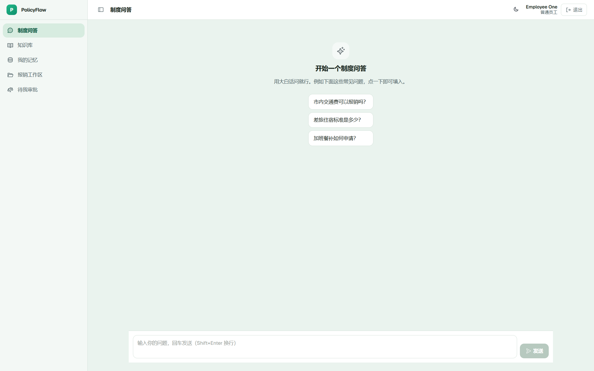
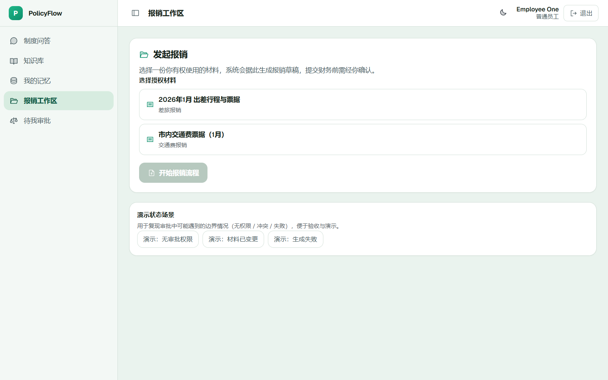
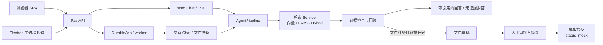

# PolicyFlow AI

PolicyFlow AI 是一个企业内部政策问答与流程助手。员工可以查询差旅、报销、请假等制度，查看回答引用的原文，也可以根据制度生成清单和待填写的草稿。

问答采用 RAG 检索和工具调用：先查知识库，再依据检索结果回答。多轮对话支持上下文补全和记忆；涉及提交的操作需要人工审批。


<p align="center">
  
</p>

## 功能

| 模块 | 功能 | 当前状态 |
|---|---|---|
| 制度问答 | SSE 流式回答、文档引用、检索进度；“给我模板”等短跟进会结合历史改写查询 | Web 可用；桌面任务已接入同一 AgentPipeline |
| 多轮记忆 | 保存近期对话、滚动摘要和长期记忆；支持查看、删除本人的记忆 | 可用，记忆不替代本轮制度证据 |
| 知识库 | 多库管理、按用户授权、上传后后台索引、物理删除文档和关联数据 | 可用 |
| 材料与工作区 | 按版本绑定材料、查看差异；输入原件只读 | 服务已实现，桌面目前手工输入已有材料版本 ID |
| 文件流程 | 根据政策依据生成待填写的 Markdown 报销草稿，审批后恢复任务并提交 | 本地流程已接通，提交使用 mock 连接器 |
| 评估中心 | Hit@1 / Hit@5 / Hit@10 / MRR、多策略对比、逐条结果和负样本拦截率 | 可用，结果随语料与模型配置变化 |
| 管理员治理 | 角色授予和撤销立即生效、配额健康、脱敏审计时间线、失败任务恢复 | 已实现，审计可按 run_id 查询 |
| Skill / Tool / MCP | Skill 根据证据组织业务规程，Tool 调用记录审计，MCP 使用 stdio/http 协议 | 企业连接器返回 `status=mock` |
| 桌面端 | Electron 主进程代理认证与 SSE；渲染进程不持有 token、Node 或任意文件访问权限 | 业务任务和事件契约已修复，完整 GUI E2E 待复验 |

界面使用 React 19、Vite 和 antd，支持浅色、深色主题。路由在 `route-elements.tsx` 中通过 `React.lazy` 拆包。

无可靠检索证据时，默认拒绝生成制度结论。启用模型参考回答时，界面会标注“模型参考 · 不可信”。文件流程的外部提交目前为模拟提交，响应带 `status=mock`。

<p align="center">
  
</p>

## 快速开始

需要 Python 3.11+ 和 Node.js（20.19.x 及以上的 20.x，或 22.12+）。下例使用 conda，也可以自行创建 Python 虚拟环境。

```powershell
git clone https://github.com/Shen-An/policyflow-ai.git
cd policyflow-ai

conda create -n policyflow python=3.11 -y
conda activate policyflow
pip install -e ".[dev]"

copy .env.example .env      # macOS/Linux: cp .env.example .env
# 在 .env 中配置：
#   SECRET_KEY=<长随机字符串>
#   BOOTSTRAP_ADMIN_PASSWORD=<管理员密码>

cd frontend; npm install; cd ..
.\start.bat                  # 或 python start.py
```

打开 `http://127.0.0.1:8000`，用 `admin` 和设置的密码登录。

首次使用需要在模型设置中配置 Chat 和 Embedding 服务，支持 OpenAI 兼容接口。随后在知识库上传制度文档，等待索引完成后即可提问。

默认启动使用 SQLite 和本地检索，适合开发与演示。PostgreSQL 的 RLS 和迁移检查需要在企业栈中单独验证。

<details>
<summary>桌面与企业栈启动</summary>

桌面端：

```bash
npm --prefix frontend run electron:build   # 构建 renderer + main/preload
npm --prefix frontend run electron:start
npm --prefix frontend run test:electron    # WDIO 安全套件
```

企业栈包括 PostgreSQL 16、Milvus、MinIO、Redis 和 RabbitMQ：

```bash
docker compose -f infra/dev/compose.yaml up -d
```

数据库按 expand、backfill、enforce 顺序迁移：

```powershell
$env:DATABASE_URL = "postgresql+psycopg://<user>:<pass>@<host>:5432/<db>"
alembic upgrade 001                            # expand：增加字段
python -m migrations.backfill_legacy_tenant    # backfill：带账本和校验和，可重跑
alembic upgrade head                           # enforce：NOT NULL / 复合唯一 / FORCE RLS
```

已有 legacy 数据时，先完成回填再收紧约束。跳过回填直接执行 `alembic upgrade head` 会被迁移检查阻止。

</details>

## 检索与评估

评估页以 Hit@1、Hit@5、Hit@10 和 MRR 为主。记录结果时需要同时注明检索策略、样本量 N 和干扰文档设置；embedding 模型和语料变化也会影响结果。

1. 导入 CRUD_RAG 的 `questanswer_*` 问答金标，数据只进入 `code=eval_test` 的“测试库”。建议同时导入至少 200 篇干扰文档。
2. 先随机抽取 50 或 100 条用例。大批量用例叠加多种策略会增加运行时间。
3. 查看各策略的 Hit@K / MRR，再展开逐条结果检查未命中的问题。

负样本没有可回答的金标，单独统计 `negative_gate` 拦截率，不计入 Hit@K / MRR。看板的 N 只统计正样本。

Hybrid 通过 RRF 融合向量与 BM25 检索结果，默认本地 rerank 使用词法融合。也可以在 run 中选择 NVIDIA cross-encoder，服务不可用时返回 503。整篇文档匹配的简单任务中，Hybrid 和 BM25 可能接近，应结合具体任务解释差异。

[realcorpus_parity.json](artifacts/graph/stage3/realcorpus_parity.json) 中的 embedding `hit@1=1.0` 来自 1 篇目标文档和 2 篇干扰文档，用于检查图切换前后的一致性。11 月修复测试中的 BM25 N=1 也用于验证 worker 接线。这两组数据都不作为检索质量结论。

## 架构



Web Chat、Eval 和桌面业务任务使用同一 AgentPipeline。检索由 Service 提供；Skill 在本轮证据上组织清单、对比和模板，Tool 执行具体操作。

桌面文件流程分为准备和恢复两个 durable job。准备阶段保存只读输入、ChangeSet、审批摘要和 AgentRun checkpoint，等待审批时释放 worker 租约。批准后校验材料版本、草稿哈希和权限，再由 SubmissionService 执行至多一次模拟提交。

| 设计项 | 当前实现 | 测试或说明 |
|---|---|---|
| 共用问答编排 | Chat / Eval / 桌面调用同一 AgentPipeline；生产持久图的完整迁移仍在进行 | [修复报告](specs/001-enterprise-agent-refactor/repair-report-2026-11-15.md)、T053 |
| 服务端授权 | 请求与任务执行时检查身份和权限；资源读取时，越权与不存在返回同形 404 | `tests/security/`、`tests/integration/test_admin_rbac.py` |
| 评估清理隔离 | 读取、删除、禁用和统计均限定认证租户 | `tests/contract/test_eval_cleanup_tenant.py` |
| 审批与提交 | 保存差异、哈希、副作用和有效期；审批决定与恢复任务原子提交 | `tests/contract/test_business_jobs.py`、`tests/recovery/test_submission_idempotency.py` |
| 状态恢复 | run、job、审批和 SSE milestone 持久化；重连携带 Last-Event-ID | `tests/recovery/test_run_restart_recovery.py`、`tests/contract/test_sse_endpoint.py` |
| 证据门控 | 无可靠证据时拒答，记忆与偏好不修改制度结论 | `tests/eval/test_evidence_gate_parity.py`、`tests/integration/test_entrypoint_conclusion_parity.py` |

开发环境使用 SQLite。企业栈的分工是 PostgreSQL 保存租户数据并执行 RLS，Milvus 保存向量，MinIO 保存版本化对象，Redis 提供配额和 SSE 回放，RabbitMQ 分发持久任务；worker 使用租约和 CAS 协调执行。

## 验证

以下结果来自 2026-11-15 的本机运行，完整命令和适用范围见 [修复报告](specs/001-enterprise-agent-refactor/repair-report-2026-11-15.md)。

| 检查 | 结果 | 日志 |
|---|---|---|
| 后端全量 pytest | 981 passed / 197 skipped / 0 failed，307.45 秒 | [pytest-final.txt](artifacts/review/2026-11-15/pytest-final.txt) |
| 前端 Vitest | 49 个文件，167 passed | [vitest-final.txt](artifacts/review/2026-11-15/vitest-final.txt) |
| Ruff / TypeScript / ESLint | 通过 | [Ruff](artifacts/review/2026-11-15/ruff-final.txt)、[TypeScript](artifacts/review/2026-11-15/typecheck-final.txt)、[ESLint](artifacts/review/2026-11-15/lint-frontend-final.txt) |
| 生产前端构建 | 通过 | [build-final.txt](artifacts/review/2026-11-15/build-final.txt) |
| 生产浏览器 E2E | 19 passed，10 workers，25.5 秒 | [production-final-3.txt](artifacts/review/2026-11-15/production-final-3.txt) |

197 个跳过的测试包括需要 PostgreSQL、Milvus、MinIO、Redis、RabbitMQ 等外部依赖的套件。浏览器 E2E 使用 FastAPI 和隔离 SQLite，LLM / LightRAG 使用确定性替身；它覆盖页面、API 和并发交互，模型与检索质量需要另行评测。

在项目根目录运行：

```powershell
conda activate policyflow
python -m pytest -q -ra --tb=short
python -m ruff check backend/app --output-format concise

npm --prefix frontend run typecheck
npm --prefix frontend run lint
npm --prefix frontend test

$env:POLICYFLOW_PYTHON = (Get-Command python).Source
npm --prefix frontend run e2e:production
```

生产 E2E 需要空闲的 8000 和 4173 端口，会使用项目内专用的 `frontend/.tmp/e2e-backend` 测试目录。测试耗时和 skip 数取决于本地环境。

## 当前进度

[任务清单](specs/001-enterprise-agent-refactor/tasks.md) 共 164 项：145 项完成、19 项部分完成、0 项未开始。后续工作主要包括：

- 文件流程：完整材料选择器、生产沙箱执行器。当前只生成待填写 Markdown，不解析票据、不修改原件；生产缺少执行器时返回 `MISSING_DEPENDENCY`。
- 编排与数据迁移：完成目标持久图的输出和事件契约对齐，继续 T035 服务层迁移。旧 adapter 和旧界面保留使用遥测，数据权威切换及 destructive contract 需先具备消费者清单和恢复点，并完成一个发布窗口的零使用检查。
- 企业栈：在对应环境验证 PostgreSQL / RLS、对象存储、RabbitMQ 恢复、gVisor 内核隔离与 Linux prefork 资源生命周期。当前没有 K8s 集群，gVisor manifest 和策略已准备，本机只验证路径校验。
- 容量：已有 2200 用户 profile（1000 会话、1000 SSE、200 文件与隔离），并发采集和逐帧 SSE 计时已实现。1000 held-open SSE、30 分钟 soak、200 RPS / p95 仍是待验收目标。
- 桌面交付：复验完整 Electron GUI E2E，生成签名包。签名门和 fuses 已实现，企业证书尚未提供。
- 用户研究：SC-010 的“90% 员工在 5 分钟内完成核心流程”和 SC-011 的“评分至少 4/5”尚无真实被试结果。

<details>
<summary>历史验收与修复记录</summary>

### 编排迁移（2026-11-01）

当时 Chat / Eval 使用 `pipeline_graph`，文件流程使用 `builder.py` 的持久图，`route_adapter.py` 负责遥测和委派。两个图的共享节点已抽到 `graph/nodes.py`。迁移方案见 [review-fixes-2026-10-21.md](specs/001-enterprise-agent-refactor/review-fixes-2026-10-21.md) §1；完整迁移需要对齐 router、plan、skill、compliance、diagnostics、ToT 双请求暂停以及 SSE 事件顺序，涉及 `agents/`、`graph/`、`services/` 和 `api/`。

切片 1 将 `ChatTurnState` 与 route / ToT / execute 节点抽到 `backend/app/graph/{state,nodes}.py`，两图共用实现。`ChatShadowRunner` 的 `GRAPH_SHADOW_MODE` 默认 `false`，影子运行使用 `disable_side_effects=True`，不写库、不执行 skill，答案只记录长度和 sha256 前缀。

切片 2 对 `/api/chat` 的 PipelineResult 和影子结果逐字段、逐事件比较，运行期记录写入 `artifacts/graph/shadow/`。当时的结果：

- 字段差异为 `answer.confidence` 和 `skills`。影子不执行 skill，少了 `grounding.py` 的 0.03 加分，confidence 从 0.67 变为 0.64；`unexplained_mismatches` 为空。router、检索证据数、compliance、errors 和 reasoning_mode 一致。
- 前 17 个事件逐位相同，随后 `stage` 回调与 `diagnostics_partial` 错位一位，权威路径 31 个事件、影子路径 30 个。客户端的 `plan` / `plan_step` 均保留。
- 记录同时保留严格的 `match` 和排除已归因差异后的 `comparable_match`。

这轮保留 AgentPipeline 和默认关闭的影子模式。持久图切换仍需对齐 skill / confidence 和事件顺序，增加样本，并运行全量问答契约。记录见 [切片 2 报告](artifacts/acceptance/t053-slice2-shadow-parity-2026-11-01.md) 和 [汇总](artifacts/acceptance/shadow-parity-summary.txt)。2026-11-15 的桌面接线已更新，当前文件审批恢复使用 AgentRun checkpoint，T053 仍为部分完成。

### 历史测试与验收

2026-11-01 后端全量为 967 passed / 197 skipped / 0 failed，日志见 [pytest-full-2026-11-01-kbasync2.txt](artifacts/acceptance/pytest-full-2026-11-01-kbasync2.txt)。2026-10-21 前端为 48 个文件、162 passed，内部契约为 23 passed / 0 xfail，负载测试为 29 passed。`test_readiness_distinguishes_unmigrated_from_unreachable` 的历史失败通过 `require_pg_server()` 在 PG 不可达时跳过处理，本机该用例为 1 skipped。

[综合验收总账](artifacts/acceptance/SC-001-SC-016.md) 在 2026-11-01 的记录如下：

| 判定 | 数量 | 项目 |
|---|---|---|
| pass | 7 | SC-007 已测试入口的授权与租户隔离、SC-008 至多一次副作用、SC-009 重启恢复、SC-012 无障碍、SC-013 三入口证据门控一致、SC-014 无证据拦截、SC-015 发现预置故障 |
| partial | 1 | SC-006 容量报告机制 |
| inconclusive | 8 | SC-001–005 容量与 soak、SC-010/011 用户研究、SC-016 数据权威切换 |

SC-012 覆盖老页面、3 个 admin 页和移动导航抽屉。上述 verdict 对应当时的验收范围；11 月发现的评估清理跨租户问题已另加双租户回归，不能把历史 SC-007 推广为所有接口的验证结果。

### Electron 与容量排查

2026-10-18 Electron GUI E2E 为 8 spec / 33 passed，耗时 1 分 55 秒，使用 Electron 44 和 Chromium 152。后续复跑为 0 passed / 8 failed，均卡在建会话阶段并报 `DevToolsActivePort file doesn't exist`。10 月 21 日直接运行 `electron.exe --app=dist-electron/main/index.cjs` 也立即退出，stdout / stderr 为空，退出码为 `-2147483645`（`0x80000003` STATUS_BREAKPOINT）。

加入 `--no-sandbox --disable-gpu` 后，进程出现 userData 锁拒绝访问（`Lock file can not be created: 拒绝访问 (0x5)`）和 `GPU process launch failed`，随后退出 0。WDIO 配置已删除宿主注入的 `ELECTRON_RUN_AS_NODE=1`，但该环境的 GUI 启动仍失败。11 月另行修复了业务 handler 和 SSE 契约；完整 GUI 复验仍待支持的宿主环境。

[容量排查记录](artifacts/acceptance/capacity-boundary-2026-10-21.md) 覆盖限流与降级：`tests/load/test_stage4_capacity.py` 为 3 passed，使用 Redis，100 并发过载时只放行预算内请求，其余返回带 `Retry-After` 的 429 / 503，无 5xx；SSE 收尾 gauge 归零，Redis 断连时 admission fail-closed。该结果没有给出吞吐量或 p95 容量结论。

### 2026-10-21 至 11-01 的修复

| 修复 | 验证或改动 | commit |
|---|---|---|
| 前端 lint 12 error + 1 warning | 拆分 `button-variants.ts` / `chip-tone.ts` / `use-color-mode.ts`，effect 内 setState 改渲染期调整，`<details>` 改受控 open；ESLint / TypeScript 通过，Vitest 48 文件 / 162 passed | `8ed6b2e` |
| JobQueue lane 过滤 | `JobService.lease(..., lanes=...)` 与 LocalJobRunner 透传；契约 23 passed / 0 xfail | `8ed6b2e` |
| `.gitignore` 忽略证据日志 | 增加 `!artifacts/**/*.log`，7 份日志入库 | `8ed6b2e` |
| T152 preflight 引用分类 | 45 处引用按列门和路径门分类，列消费者实际 1 处，其余阻塞在 T159 / T160 模型退场 | `573e2d3` |
| T035 Eval 路由同步阻塞 | 14 个端点中 4 个为 async，3 处同步调用改线程池；当时未改 eval_service，新增回归 2 passed，T035 保留部分完成 | `fb831fc` |
| 新安装管理员接口返回 403 | ROLE_SEEDS 增加 actions，仅回填空列表；角色种子测试 3 passed，相关子集 96 passed | `8c6b5c3` |
| 治理页直方图渲染崩溃 | 前端将 `Array<{value,count}>` 修正为数组处理，替换原 `Record<string,number>` 假设，toHealth 直传、CountList 遍历数组 | `fe7ec81` |
| 3 个 admin 页缺少 E2E | f8 的 5 个用例通过：3 页 axe wcag2a / 2aa / 21a / 21aa、6 个 admin 读接口 200、capacity 403、employee 越权重定向；f7 通过，SC-012 升为 pass | `fe7ec81` |
| T053 共享节点 | 抽出 graph/state.py、graph/nodes.py、graph/shadow.py；route / ToT 共用实现，execute 为薄适配；950 passed / 197 skipped，约 550 行 _execute_plan 编排未迁移，T053 保留部分完成 | `fe7ec81` |
| f0–f6 的 12 条陈旧 E2E 定位器 | 7 个 spec 按 hash 路由、antd Modal.confirm、本地化标签和 page-toolbar 作用域更新；TypeScript / ESLint 通过，E2E 19 passed | `d391bc2` |
| 移动端导航抽屉 | app-shell.tsx 增加“打开导航”、aria-expanded、aria-controls 和 Escape 关闭，复用主导航；899px 以下隐藏 rail，f1 的 5 个用例通过 | `d391bc2` |
| T035 文档索引同步阻塞 | routes_kb.py 的 create_index_job 改在线程池中调用；新增回归 2 passed，回退为内联时 1 failed；当时未改 knowledge_base_service，961 passed / 197 skipped | `8b029ca` |
| T035 知识库读取 | KnowledgeBaseRepository 与 UnitOfWork.knowledge_bases 接入 4 个 async 端点；ACL 共用 subject_pairs_for / resolve_permission_level；6 passed，含同步 get_documents 对照和事件循环 spy；当时未改 eval_service，967 passed / 197 skipped | `46ea8bb` |

7 份证据日志包括 `artifacts/ui/stage8/{e2e-full,accessibility}.log`、`artifacts/acceptance/quickstart-server.log`、`artifacts/load/baseline/{run,runner-console}.log` 和 `artifacts/pg-{start,phase9}.log`。

11 月 1 日 Playwright 全量 19 passed，耗时 1.3 分钟，日志见 [e2e-full-2026-11-01e.txt](artifacts/acceptance/e2e-full-2026-11-01e.txt)。当时 f5 覆盖检索 Run 成功及 Hit@1 / MRR 展示，未覆盖缺少 eval_test 种子语料的回答评估分支。rc-select 展开后的隐藏 listbox 缺少 aria-label，axe 检查采用页面首次渲染态，未关闭规则。Electron 整机 E2E 另行验收。

</details>

## 目录

```text
backend/app/        FastAPI：api / services / graph / jobs / quota / storage
                    retrieval / sandbox / approvals / sse / db / auth / observability
frontend/src/       React SPA（features/* 按业务域）
frontend/electron/  桌面外壳：main / preload / shared
migrations/         Alembic 分阶段迁移 001–005 + legacy 回填
infra/              compose.yaml、gVisor sandbox manifest
tests/              单元 / 契约 / 集成 / 安全 / 恢复 / 迁移 / 核对 / 负载
artifacts/          各阶段日志、截图、哈希与 JSON
specs/              规格、计划与任务清单
```

## 文档

| 内容 | 文档 |
|---|---|
| 当前任务进度 | [tasks.md](specs/001-enterprise-agent-refactor/tasks.md) |
| 11 月审查与 R1–R5 修复 | [审查记录](specs/001-enterprise-agent-refactor/progress-review-2026-11-15.md)、[修复报告](specs/001-enterprise-agent-refactor/repair-report-2026-11-15.md) |
| 综合验收 | [SC-001-SC-016.md](artifacts/acceptance/SC-001-SC-016.md) |
| 10 月审查修复 | [review-fixes-2026-10-21.md](specs/001-enterprise-agent-refactor/review-fixes-2026-10-21.md) |
| Skill / Tool / MCP 与评估策略 | [docs/08](docs/08-de-toy-multiagent-skill-eval-strategy.md) |
| 数据库迁移、多租户与 RLS | [docs/12](docs/12-postgresql-multitenancy-design.md) |
| RAG、评估与记忆设计 | [docs/04](docs/04-ai-pipeline-rag-eval-design.md) |
| 项目早期总结 | [docs/10](docs/10-project-summary.md) |
| 面试演示与术语 | [docs/interview/](docs/interview/README.md) |

## 角色

| 角色 | 权限 |
|---|---|
| `employee` | 问答、写草稿、查看被授权的知识库、发起和查看审批 |
| `kb_admin` | 维护知识库、审核 FAQ、运行评估 |
| `sys_admin` | 用户与角色管理、审计、Skill / MCP / 模型配置、租户治理 |
| `cross_tenant_admin` | 跨租户只读，例如平台容量；默认不授予 |

## 配置注意事项

- 更换 embedding 模型或维度后需要重建索引。
- 记忆和偏好不写入制度条款，也不覆盖本轮检索证据。
- 部署时设置独立的 `SECRET_KEY` 和管理员密码。桌面 token 由主进程通过 OS `safeStorage` 保存。

## License

MIT
